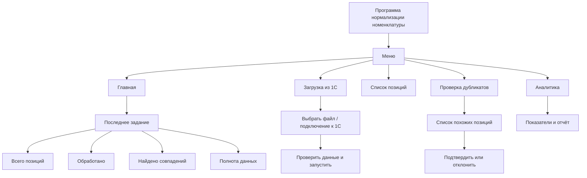

# Пример макета интерфейса

Это пример того, как может выглядеть главная страница программы.

## Инструкция

- На главной странице пользователь видит общие результаты последней обработки.
- В разделе загрузки можно выбрать данные из 1С и запустить обработку.
- В разделе дубликатов можно посмотреть найденные совпадения и принять решение.
- В аналитике отображаются основные показатели и отчёт.
